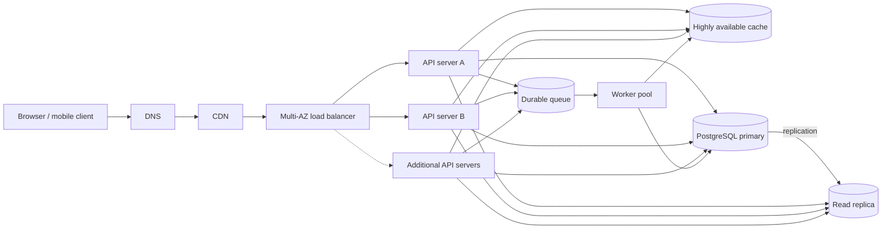

# QuickNotes Architecture

## Requirements

### Functional

- Register and authenticate users, then authorize every private request against
  the authenticated user's identity.
- Create, read, update, and delete notes; require a non-empty title of at most
  100 characters and allow an optional body.
- Create and list user-owned tags and associate tags with notes.
- Paginate note lists, return consistent JSON errors, and keep each user's data
  private from other users.
- Support the API described in [api-design.md](./api-design.md) using the
  relational schema in [data-model.md](./data-model.md).

### Non-functional

- Serve 1 million registered users with horizontally scalable application
  capacity and no dependency on a single application instance or availability
  zone.
- Target 99.9% monthly API availability and p95 API latency below 300 ms for
  ordinary note reads and writes, excluding client network time.
- Protect credentials and note content in transit with TLS and at rest with
  encryption; use least-privilege access, secure password hashing, and
  monitored audit events.
- Preserve acknowledged writes using durable database storage, backups, and
  tested point-in-time recovery; recover from an availability-zone failure.
- Make background work durable and retryable, and expose metrics, logs, traces,
  and health checks for operations.

## Load and storage estimate

These are initial capacity-planning assumptions, not measured production
traffic:

- 1,000,000 registered users; 20% (200,000) use the service on an average day.
- Each daily active user makes 10 note-list/read requests and 2 write requests
  per day. For a conservative storage upper bound, count every write as a new
  note rather than an update or delete.
- Peak traffic is estimated at 5 times the daily average.
- An average stored note, including row metadata and its allocated index/tag
  overhead, uses approximately 4 KB. This excludes backups, replicas, WAL,
  and temporary database overhead.

| Measure | Estimate |
| --- | --- |
| Reads per day | 200,000 × 10 = 2,000,000 |
| Average reads per second | 2,000,000 ÷ 86,400 ≈ 23 |
| Peak reads per second | 23 × 5 ≈ 116 |
| Writes per day | 200,000 × 2 = 400,000 |
| Average writes per second | 400,000 ÷ 86,400 ≈ 4.6 |
| Peak writes per second | 4.6 × 5 ≈ 23 |
| New notes per year (upper-bound assumption) | 400,000 × 365 = 146,000,000 |
| Logical storage growth per year | 146,000,000 × 4 KB ≈ 584 GB (decimal) |

Actual storage growth will be lower if writes mostly update existing notes,
and higher if bodies or indexes are larger than the estimate. Recalculate
these figures from real usage, retention, and body-size metrics before
committing to database capacity.

## High-level architecture

## Component responsibilities

- **Client:** Provides the user interface and sends authenticated API requests
  over HTTPS without holding authoritative application data.
- **DNS:** Resolves the service hostname to the public edge and supports
  health-aware routing during regional or endpoint changes.
- **CDN:** Caches versioned static assets close to users and absorbs repeat
  asset traffic; authenticated, private API responses are not publicly cached.
- **Load balancer:** Terminates or forwards TLS, performs health checks, and
  distributes API traffic across healthy application servers and zones.
- **API servers:** Run multiple stateless instances to authenticate requests,
  enforce ownership and validation rules, and implement the REST API.
- **Cache:** A highly available distributed cache holds short-lived,
  non-authoritative hot data to reduce repeated database reads; invalidation
  and expiry prevent stale entries from becoming the source of truth.
- **Primary database:** PostgreSQL is the durable source of truth and handles
  transactions and all note, user, tag, and association writes.
- **Read replica:** A separate PostgreSQL replica serves eligible read
  traffic, reducing load on the primary while replication distributes committed
  data asynchronously.
- **Queue:** A durable replicated queue buffers non-critical background work
  so transient worker outages do not block API responses or lose accepted
  jobs.
- **Worker:** Multiple worker instances process queued work such as
  audit/analytics events and cache-maintenance jobs, with retries and
  idempotency for safe recovery.

## Request flows

### `GET /api/v1/notes`

1. The client resolves the API hostname through DNS and sends the request over
   HTTPS; the CDN serves static assets but passes this authenticated API
   request through without shared caching.
2. The load balancer selects a healthy API server. The server validates the
   bearer token and derives the user ID from the authenticated identity.
3. The API server checks the cache for a page keyed by user, pagination
   cursor, and relevant query parameters; cached data is never shared between
   users.
4. On a cache miss, the server queries the read replica for that user's
   newest-first page, using the user-scoped index and cursor.
5. The API server assembles the JSON response, caches eligible results with a
   short expiry, and returns the page and next cursor to the client.
6. If the replica is unhealthy or too far behind, reads that require
   read-your-writes consistency go to the primary; the service may route
   ordinary reads to the primary until replica health recovers.

### `POST /api/v1/notes`

1. The client sends the note JSON and bearer token over HTTPS; DNS, CDN
   pass-through, and the load balancer route it to a healthy API server.
2. The server authenticates the user, validates the title and body, and
   assigns ownership from the token rather than trusting a client-supplied
   user ID.
3. In a database transaction, the server writes the note (and any valid tag
   associations) to the primary. The transaction enforces foreign keys and
   ownership, and the server waits for the configured durability
   acknowledgment.
4. After commit, the API invalidates or versions affected per-user cache
   entries and publishes any non-critical follow-up work to the durable queue.
   A queue outage must not turn a committed note into a failed create; the
   implementation should use a transactional outbox or another reliable
   publish-after-commit pattern.
5. The server returns `201 Created`, the created note, and its `Location`
   header. The read replica receives the committed change through replication;
   until it catches up, read-your-writes requests use the primary.
6. Workers process queued jobs independently and retry transient failures
   without repeating side effects.

## Trade-offs and availability

1. **Read scaling versus immediate consistency:** Serving list requests from a
   read replica increases read capacity but asynchronous replication can lag.
   Route read-your-writes traffic to the primary and monitor replica lag;
   temporarily direct reads to the primary when lag exceeds the accepted
   bound.
2. **Cache latency versus freshness:** Caching reduces database work and
   response time, but introduces stale-data risk and invalidation complexity.
   Cache only user-scoped, non-authoritative results with bounded expiry, and
   invalidate or version affected keys after successful writes.
3. **Synchronous writes versus queue-based work:** Waiting for the database
   commit ensures the API does not acknowledge a note that was not saved, but
   it adds primary-database latency to writes. Keep only authoritative writes
   synchronous and move non-critical work to a durable queue using an
   outbox/retry design.
4. **Relational integrity versus horizontal write scaling:** A PostgreSQL
   primary simplifies transactions and ownership constraints, but all writes
   initially depend on that primary. Scale vertically and optimize indexes
   first; add partitioning or carefully designed sharding only when measured
   write capacity requires it, since those options add operational complexity.

No single server or availability zone should be a single point of failure:
run multiple stateless API servers and workers across zones; deploy redundant
DNS, CDN edge, and load-balancer capacity; and use a replicated cache and
durable multi-node queue. The primary database is a logical write leader, so
it remains the most consequential failure domain: run it as a managed
multi-zone service with automated replica promotion, frequent backups, and
point-in-time recovery. Promotion can still cause a short write interruption;
monitor and document recovery objectives rather than claiming uninterrupted
writes. Test failover and restore procedures regularly.
